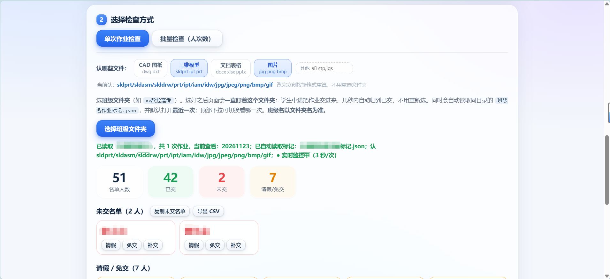
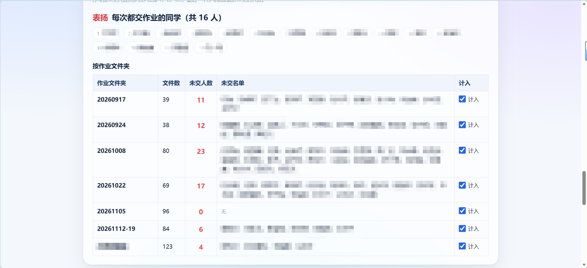

# CAD 作业收交清点台

中职 CAD 机房收作业用的小工具。选一次班级文件夹，自动比对花名册，几秒内列出谁没交；学生中途交了作业，页面会自动更新，不用重新选文件夹。


## 在线使用（需联网）

https://392084182-oss.github.io/ComputerR-homework-checker/

也可以把 `index.html` 下载到本地双击打开，完全离线，不需要安装任何东西。

## 为什么做这个

机房收 CAD 作业，学生交上来的文件一堆 `新建 CAD 图形.dwg`、`1101.dwg`，肉眼数谁没交很费时间。这个工具只读文件名、按姓名比对花名册，几秒出结果。

## 功能

- 导入花名册（`.xlsx`），多班级分别管理
- **单次作业比对**：选班级文件夹，列出这一次谁没交
- **整学期批量比对**：一次算出每人缺交次数、全勤名单
- 缺交名单一键复制、导出 CSV（表头在第 1 行，Excel 可直接排序、做透视）
- 请假 / 免交 / 补交 / 人工标未交，标记可导出为 json，下次自动读回
- 平时分自动计分（可配占比与扣分规则），可导出
- 选一次文件夹后**实时监控**：学生交作业几秒内自动归到已交

## 使用步骤

1. 导入花名册（每个班一个 `.xlsx`，文件名里带班级名）
2. 选「当前比对班级」
3. 勾选这次**认哪些文件**（见下）
4. 点「选择班级文件夹」，选该班的作业目录（里面按日期分了子文件夹）
5. 看未交名单；学生中途交了，页面会自动刷新

### 认哪些文件

不同课收的格式不一样，第 2 步可以勾选：

| 组 | 扩展名 |
|---|---|
| CAD 图纸 | `dwg` `dxf` |
| 三维模型 | `sldprt` `sldasm` `slddrw`（SolidWorks）、`prt`（NX / UG）、`ipt` `iam` `idw`（Inventor） |
| 文档表格 | `docx` `doc` `xlsx` `xls` `pptx` `ppt` `pdf` |
| 图片 | `jpg` `jpeg` `png` `bmp` `gif` |
| 其他 | 自己填，如 `stp`、`igs` |

默认勾「CAD 图纸 + 三维模型 + 图片」，选择会被记住，下次打开还是这套。

改完**立刻按新格式重算，不用重新选文件夹**。

如果文件夹里有一批文件因为格式没勾被排除，页面会主动提示「这里有 38 个 .sldprt 没算进来」，点一下就能勾上。

## 界面预览

**导入花名册** —— 一次导入多个班的名单，班级名从文件名自动取，人数自动统计。


**单次作业比对** —— 选一次作业，一眼看到已交、未交、请假免交各多少人；未交名单可直接复制或导出 CSV。



**批量作业比对** —— 整学期汇总，谁缺交几次、缺的是哪几次一目了然。


**全勤表扬与逐次未交** —— 每次都交的同学单独点名；按每次作业列出未交名单，不想计入的可取消勾选。



**平时分自动计分** —— 按缺交次数自动算平时分，并给出期末要考多少分才能及格。


**打印** —— 页面底部一个「打印全页」，打印时自动去掉按钮、下拉框和屏幕提示。


## 特点

- **单文件、零依赖**：一个 HTML，无框架、无构建，下载后断网可跑
- **不读取文件内容**：只按文件名判断交没交，`dwg`、`sldprt`、`prt`、`docx` 一视同仁
- **不上传任何数据**：学生信息只存在浏览器内存里，关掉页面即消失
- **不需要账号**：纯前端，没有后端、没有服务器

## 已知边界

- 只看文件名：学生交的文件里没写姓名（只写机位号，或就叫「新建」）就认不出是谁
- 同名文件覆盖（改了内容没改文件名）不会触发自动刷新，但「交没交」的判断不变
- 实时监控依赖目录句柄 API（Chrome / Edge 等现代浏览器）；不支持的浏览器会自动降级为一次性读取，只是不再自动刷新
- 页面关掉后要重新选一次文件夹

## 提高识别率

学生文件名里带上姓名最省事，例如：

```
1101_王小明.dwg
```

纯学号也能用，只要文件名里包含花名册上的姓名片段。

## 更新记录

**2026-11-23** 首次发布

- 单次作业比对、整学期批量比对
- 选一次文件夹后通过 **showDirectoryPicker** 实时监控，学生交作业 3 秒内自动归到已交
- **认哪些文件可勾选**：CAD 图纸、三维模型、文档表格、图片，也可以自己填扩展名
- 三维模型支持 SolidWorks（`sldprt` `sldasm` `slddrw`）、NX / UG（`prt`）、Inventor（`ipt` `iam` `idw`）
- 文件夹里有大量文件因为格式没勾被排除时，主动提示，点一下就能勾上重算
- 请假 / 免交 / 补交 / 人工标未交，标记可导出 json，下次自动读回
- 平时分自动计分，缺交名单可一键复制或导出 CSV
- 打印时自动去掉按钮、下拉框和屏幕提示

## 反馈与贡献

欢迎提 Issue 说明使用场景和遇到的问题，或直接 PR。

提 Issue 时**不要贴学生真实姓名**，用「张三」「学生 A」代替即可。

## 许可证

MIT
